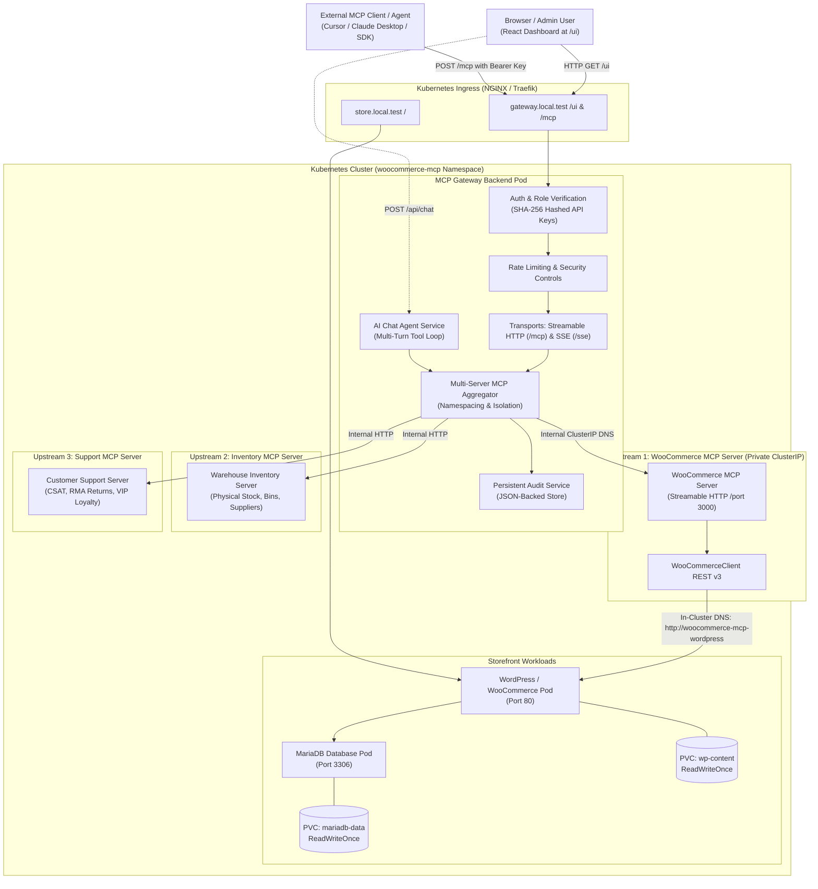
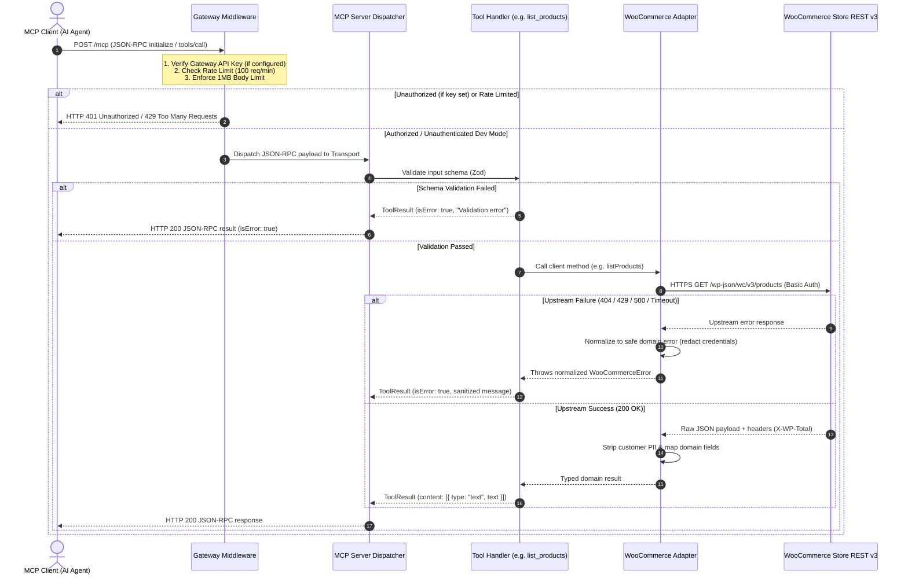

# WooCommerce MCP Gateway

[](https://www.typescriptlang.org/)
[](https://nodejs.org/)
[](https://modelcontextprotocol.io/)
[](https://kubernetes.io/)
[](https://helm.sh/)
[](https://vitest.dev/)

A production-grade, multi-server **Model Context Protocol (MCP)** gateway engineered for Kubernetes. The platform connects AI assistants, external MCP clients, and an embedded React admin dashboard with a real-time **WordPress/WooCommerce** store, a physical **Warehouse Inventory** MCP server, and a **Customer Support** MCP server through a unified, secure MCP entrypoint.

---

## 📑 Table of Contents

- [1. Project Purpose & Scope](#1-project-purpose--scope)
- [2. System Architecture](#2-system-architecture)
- [3. Multi-Server Upstream Management & Tool Catalog](#3-multi-server-upstream-management--tool-catalog)
- [4. React Admin Dashboard & AI Chat Agent](#4-react-admin-dashboard--ai-chat-agent)
- [5. Authentication, Roles & API Key Lifecycle](#5-authentication-roles--api-key-lifecycle)
- [6. Persistent Audit Logging & Privacy Controls](#6-persistent-audit-logging--privacy-controls)
- [7. Technology Stack & Design Decisions](#7-technology-stack--design-decisions)
- [8. Prerequisites & Local Setup](#8-prerequisites--local-setup)
- [9. Environment Configuration](#9-environment-configuration)
- [10. Connecting External MCP Clients (Cursor, Claude Desktop, SDK)](#10-connecting-external-mcp-clients-cursor-claude-desktop-sdk)
- [11. Kubernetes & Helm Deployment (Local & VPS k3s)](#11-kubernetes--helm-deployment-local--vps-k3s)
- [12. Windows PowerShell Command Reference](#12-windows-powershell-command-reference)
- [13. End-to-End Acceptance Test Matrix (Scenarios A through G)](#13-end-to-end-acceptance-test-matrix-scenarios-a-through-g)
- [14. Demo Recording & Submission Checklist](#14-demo-recording--submission-checklist)
- [15. Troubleshooting Guide](#15-troubleshooting-guide)
- [16. Known Limitations & Security Notes](#16-known-limitations--security-notes)

---

## 1. Project Purpose & Scope

The **WooCommerce MCP Gateway Platform** is engineered to meet all requirements of the Urumi AI FDE Internship Round 1 Assignment:

- **WordPress / WooCommerce Store**: Full ecommerce storefront backed by persistent MariaDB database and persistent `wp-content`.
- **Custom WooCommerce MCP Server**: In-cluster, strictly private Streamable HTTP MCP server exposing catalog and order management tools with schema validation and PII exclusion.
- **Multi-Server Aggregation Gateway**: Aggregates tools from multiple registered upstream MCP servers into a single unified endpoint (`/mcp` and `/sse`) with deterministic namespacing, collision handling, and upstream failure isolation.
- **3 Distinct Real Upstream Servers**:
  1. `wc`: WooCommerce Storefront & Orders (12 tools)
  2. `inv`: Warehouse Inventory & Physical Stock (3 tools)
  3. `sup`: Customer Support & RMA Returns (3 tools)
- **Role-Based Authentication & Hashed API Keys**: Admin and Member roles, individual SHA-256 hashed API keys, and instantaneous key revocation.
- **Persistent Audit Logging**: Detailed audit records capturing user identity, tool name, upstream server, duration in ms, and success/failure outcome without credential leakage.
- **React Admin Dashboard**: Interactive single-page dashboard for upstream management, health monitoring, tool testing, user/key administration, audit inspection, and conversational AI chat.
- **Tool-Calling Chat Agent**: LLM-driven chat agent executing multi-turn tool loops exclusively through the gateway's unified endpoint.
- **Reusable Helm Charts**: Deployable on local Kubernetes (Docker Desktop / Minikube / kind) and production-like VPS **k3s**.

---

## 2. System Architecture



*For detailed component breakdowns, see [docs/architecture.md](file:///c:/Users/DELL/OneDrive/Desktop/woocommerce-mcp-gateway/docs/architecture.md).*

---

## 3. Request & Execution Flow



---

## 4. Technology Stack & Design Decisions

| Layer | Technology | Rationale & Design Decision |
| :--- | :--- | :--- |
| **Language & Runtime** | Node.js `22.16.0 LTS` + TypeScript `5.7` | Modern JavaScript ecosystem, strict null checking (`strict: true`), native `fetch` and `AbortController`. |
| **MCP SDK** | `@modelcontextprotocol/sdk` (v1.6.0) | Official reference implementation ensuring strict JSON-RPC 2.0 and capability negotiation compliance. |
| **HTTP Gateway** | Express `5.2.1` | Robust microservice routing, lightweight middleware pipeline, native promise error handling. |
| **Validation** | Zod `3.24.2` | Runtime schema validation for boot configurations and tool invocation parameters. |
| **Structured Logging** | Pino `9.6.0` | Ultra-fast JSON logging with path-based secret redaction engine for zero credential leakage. |
| **Test Runner** | Vitest `3.0.6` | High-speed ESM-native test execution, V8 code coverage, and concurrency simulation. |
| **Container Engine** | Multi-Stage Alpine Dockerfile | Minimal production attack surface (`node:22.16.0-alpine3.21`), non-root UID 1000 execution. |
| **Orchestration** | Kubernetes Manifests (`apps/v1`) | Native horizontal pod autoscaling, rolling updates, readiness/liveness health probes. |

---

## 5. Prerequisites & Local Setup

### Prerequisites
- **Node.js**: `v20.0.0` or higher (tested and verified on `v22.16.0 LTS`).
- **npm**: `v10.0.0` or higher.
- **Docker** *(optional for container builds)*: `v24.0+`.
- **kubectl / Minikube / Kind** *(optional for cluster deployment)*: `v1.28+`.

### Local Installation
```bash
# 1. Clone repository
git clone https://github.com/anusha975/woocommerce-mcp-gateway.git
cd woocommerce-mcp-gateway

# 2. Install dependencies (verified against Node 22 LTS)
npm install

# 3. Create your local environment configuration from template
cp .env.example .env
```

> [!IMPORTANT]
> Never commit `.env` or files containing real secrets to version control. The `.gitignore` file strictly excludes `.env` and `k8s/*secret*.yaml`.

---

## 6. Environment Configuration & Integration Status

The application validates configuration on boot via Zod (`src/config/env.ts`). If required variables are missing, it fails fast with descriptive diagnostics:

| Environment Variable | Required | Default | Safe Example Value | Description |
| :--- | :--- | :--- | :--- | :--- |
| `NODE_ENV` | No | `development` | `production` | Environment mode (`development`, `production`, `test`). |
| `PORT` | No | `3000` | `3000` | Gateway HTTP server port. |
| `HOST` | No | `0.0.0.0` | `0.0.0.0` | Network bind interface. |
| `LOG_LEVEL` | No | `info` | `info` | Logger severity (`fatal`, `error`, `warn`, `info`, `debug`, `silent`). |
| `GATEWAY_API_KEY` | No | - | `sec_mcp_gateway_token_999` | Optional API token protecting `/mcp`, `/sse`, and `/messages`. When omitted (default in `.env.example`), gateway authentication is disabled (`authRequired: false`) and requests do not return 401. When configured, requests require `Authorization: Bearer <key>` or `X-API-Key: <key>` (`authRequired: true`) and missing or invalid credentials return HTTP 401. |
| `WOOCOMMERCE_BASE_URL` | **Yes** | - | `https://store.example.com` | Target WooCommerce store base URL (HTTPS required in prod). |
| `WOOCOMMERCE_CONSUMER_KEY` | **Yes** | - | `ck_placeholder_consumer_key` | WooCommerce REST API Consumer Key. |
| `WOOCOMMERCE_CONSUMER_SECRET`| **Yes** | - | `cs_placeholder_consumer_secret`| WooCommerce REST API Consumer Secret. |
| `WOOCOMMERCE_TIMEOUT_MS` | No | `10000` | `10000` | Upstream HTTP timeout in milliseconds (min 1000). |
| `WOOCOMMERCE_VERIFY_SSL` | No | `true` | `true` | Enable/disable TLS certificate validation. |
| `RATE_LIMIT_WINDOW_MS` | No | `60000` | `60000` | Rate limiting sliding window in ms (1 minute). |
| `RATE_LIMIT_MAX_REQUESTS` | No | `100` | `100` | Maximum requests allowed per IP in sliding window. |
| `CORS_ALLOWED_ORIGINS` | No | `*` | `*` | Comma-separated list of allowed CORS origins. |
| `MAX_REQUEST_BODY_BYTES` | No | `1048576` | `1048576` | Maximum request body size in bytes (1MB default). |

### Integration Status Notice
> [!WARNING]
> **Live WooCommerce Store Status**: **BLOCKED / UNVERIFIED**.
> The local development store (`https://woocommerce-test.local`) is currently unreachable on the network.
>
> **Mock-Mode Verification**: **VERIFIED**.
> All 9 MCP tools, schemas, error sanitization, timeout handling, and security controls are thoroughly verified via automated test suites and isolated mock adapters. A successful health check (`/healthz`) does **not** prove live store connectivity. Live store integration will be verified once a live WordPress instance is reachable.

---

## 7. Configuring a Test WooCommerce Store

To connect the gateway to a live or staging WooCommerce store:

1. Log in to your WordPress / WooCommerce admin dashboard.
2. Navigate to: **WooCommerce > Settings > Advanced > REST API**.
3. Click **Add key**.
4. Provide a description (e.g. `MCP Gateway Integration`), assign an Administrator user, and select **Permissions: Read** (the gateway is strictly read-only).
5. Click **Generate API key**.
6. Copy the **Consumer Key** (`ck_...`) and **Consumer Secret** (`cs_...`) into your `.env` or `k8s/secret.yaml` file.

---

## 8. Starting the MCP Server

```bash
# Development mode (hot reload via tsx)
npm run dev

# Production build and run
npm run build
npm start
```

When started, the gateway logs startup metadata to stdout:
```json
{"level":30,"time":"2026-10-09T14:00:00.000Z","name":"wc-mcp-gateway","host":"0.0.0.0","port":3000,"env":"production","mcpStreamableEndpoint":"http://0.0.0.0:3000/mcp","mcpSseEndpoint":"http://0.0.0.0:3000/sse","msg":"WooCommerce MCP Gateway server is listening"}
```

---

## 9. Connecting MCP Clients (Claude Desktop, Cursor, Inspector)

The gateway supports two official Model Context Protocol transports:
* **Streamable HTTP** (`POST /mcp`): Modern stateless JSON-RPC transport with SSE message streaming. Recommended for HTTP clients and cloud deployments.
* **Server-Sent Events (SSE)** (`GET /sse`, `POST /messages`): Long-lived event stream for persistent sessions.

---

### A. Cursor Configuration
1. Open **Cursor Settings** (`Ctrl + ,` or `Cmd + ,`).
2. Search for **MCP** and click **Add New MCP Server**.
3. Configure the server connection:
   * **Name**: `woocommerce`
   * **Type**: `sse`
   * **URL**: `http://localhost:3000/sse`
   *(Or if using Kubernetes port-forward on port 3002: `http://localhost:3002/sse`)*.
4. **Authentication**:
   * If running with default local configuration (`GATEWAY_API_KEY` omitted), authentication is disabled (`authRequired: false`)—leave headers blank.
   * If `GATEWAY_API_KEY` is configured, add header `Authorization: Bearer <GATEWAY_API_KEY>`.
5. Click **Connect**. Cursor will discover all 9 tools and enable them in Agent / Chat mode.

---

### B. Claude Desktop Configuration
Claude Desktop natively communicates with MCP servers via stdio processes. Because this gateway runs as a network service exposing Streamable HTTP and SSE transports, connecting Claude Desktop requires a stdio-to-network bridge utility such as `mcp-remote`.

> [!NOTE]
> **Client Verification Status**:
> * **Cursor** (`Type: sse`), **MCP Inspector**, and **Streamable HTTP** (`curl`): **VERIFIED** against the running gateway.
> * **Claude Desktop** (`mcp-remote` bridge): **DOCUMENTED / NOT END-TO-END VERIFIED** in this environment.

Add the gateway entry to your Claude Desktop configuration file (`claude_desktop_config.json`):
* **Windows**: `%APPDATA%\Claude\claude_desktop_config.json`
* **macOS**: `~/Library/Application Support/Claude/claude_desktop_config.json`

**Default Mode (Unauthenticated / Local Dev Mode)**:
```json
{
  "mcpServers": {
    "woocommerce": {
      "command": "npx",
      "args": [
        "-y",
        "mcp-remote",
        "http://localhost:3000/sse"
      ]
    }
  }
}
```

**Secured Mode (When GATEWAY_API_KEY is configured)**:
When authentication is enabled on the gateway, configure the API key via environment variables to avoid exposing credentials in process argument listings:
```json
{
  "mcpServers": {
    "woocommerce": {
      "command": "npx",
      "args": [
        "-y",
        "mcp-remote",
        "http://localhost:3000/sse",
        "--header",
        "Authorization: Bearer ${GATEWAY_API_KEY}"
      ],
      "env": {
        "GATEWAY_API_KEY": "<your-gateway-api-key>"
      }
    }
  }
}
```

Ensure the gateway server (`npm run dev`, Docker container, or Kubernetes port-forward) is running before launching Claude Desktop. Do not commit actual API keys to version control.

---

### C. MCP Inspector (Interactive Web GUI)
Test and debug all registered tools interactively using the official MCP Inspector:

```bash
# 1. Start the gateway server locally or ensure Docker / Kubernetes is running
npm run dev

# 2. Launch the MCP Inspector in another terminal
npx @modelcontextprotocol/inspector
```
* In the Inspector browser interface:
  * **Option 1 (SSE Transport)**: Set Transport to `SSE`, URL to `http://localhost:3000/sse`.
  * **Option 2 (Streamable HTTP Transport)**: Set Transport to `Streamable HTTP`, URL to `http://localhost:3000/mcp`.
* **Authentication**: If `GATEWAY_API_KEY` is configured, add Custom Header `Authorization: Bearer <GATEWAY_API_KEY>`. If running with default local configuration (unauthenticated mode), leave custom headers empty.
* Click **Connect** to inspect tool schemas and execute live calls.

---

### D. Direct HTTP Testing via `curl`
Initialize an MCP session directly over the Streamable HTTP transport:

**Unauthenticated Mode (Default Local Configuration)**:
```bash
curl -i -X POST http://localhost:3000/mcp \
  -H "Content-Type: application/json" \
  -H "Accept: application/json, text/event-stream" \
  -d '{
    "jsonrpc": "2.0",
    "id": 1,
    "method": "initialize",
    "params": {
      "protocolVersion": "2024-11-05",
      "capabilities": {},
      "clientInfo": { "name": "diagnostic-client", "version": "1.0.0" }
    }
  }'
```

**Secured Mode (When GATEWAY_API_KEY is configured)**:
```bash
curl -i -X POST http://localhost:3000/mcp \
  -H "Content-Type: application/json" \
  -H "Accept: application/json, text/event-stream" \
  -H "Authorization: Bearer <GATEWAY_API_KEY>" \
  -d '{
    "jsonrpc": "2.0",
    "id": 1,
    "method": "initialize",
    "params": {
      "protocolVersion": "2024-11-05",
      "capabilities": {},
      "clientInfo": { "name": "diagnostic-client", "version": "1.0.0" }
    }
  }'
```

---

## 10. Multi-Server MCP Tools Catalog

The gateway aggregates tools from three distinct upstream servers into a unified namespace:

### Upstream 1: WooCommerce Storefront & Orders (Canonical / `wc__` Prefix)
| Tool Name | Domain | Description | Key Input Parameters | Return Format |
| :--- | :--- | :--- | :--- | :--- |
| `health_check` | Diagnostic | Returns gateway health, uptime, memory, and upstream connectivity. | `verbose` (boolean, optional) | Status, uptime, Node version, memory usage. |
| `list_products` | Products | List catalog products with pagination, category, stock, and price filters. | `page`, `per_page`, `category`, `status`, `sku`, `min_price`, `max_price`, `orderby`, `order` | Sanitized products list + pagination metadata. |
| `create_product` | Products | Creates a new product in the WooCommerce catalog with price and stock management. | `name` (required), `regular_price` (required), `description`, `manage_stock`, `stock_quantity` | Created product ID, SKU, status, and price. |
| `list_orders` | Orders | Retrieve store orders with ISO 8601 date boundary and status filtering. PII excluded. | `page`, `per_page`, `status`, `after`, `before`, `orderby`, `order` | Order summaries with customer PII strictly removed. |
| `list_recent_orders` | Orders | Backwards-compatible alias for recent store order retrieval with PII exclusion. | `page`, `per_page`, `status`, `after`, `before`, `orderby`, `order` | Safe order list. |
| `get_order` | Orders | Retrieve complete order details (line items, shipping, financial totals). | `id` (integer, required) | Line item breakdown and totals (no customer PII). |
| `update_order_status` | Orders | Updates order fulfillment lifecycle status (`processing`, `completed`, `cancelled`, etc.). | `id` (integer, required), `status` (enum, required) | Updated order record and lifecycle confirmation. |
| `search_products` | Products | Full-text keyword search across product titles, descriptions, and SKUs. | `query` (string, required), `page`, `per_page` | Matching product records + count. |
| `get_product` | Products | Retrieve full product specifications by numeric ID. | `id` (integer, required) | Comprehensive specifications, categories, and inventory. |
| `get_low_stock_products` | Inventory | Scan store catalog for products below stock threshold. | `threshold` (integer, default: 5), `page`, `per_page` | Filtered list of low-stock and sold-out items. |
| `search_orders_by_status` | Orders | List orders matching an exact status (`pending`, `processing`, `completed`, `refunded`). | `status` (enum, required), `page`, `per_page` | Filtered order records + status totals. |
| `get_order_summary` | Orders | Return a safe, high-level financial summary of an order with PII excluded. | `id` (integer, required) | Financial totals, item count, and line item names. |

### Upstream 2: Warehouse Inventory Management (`inv__` Prefix)
| Tool Name | Domain | Description | Key Input Parameters | Return Format |
| :--- | :--- | :--- | :--- | :--- |
| `inv__check_warehouse_stock` | Warehouse | Checks physical warehouse aisle, bin, on-hand units, reserved units, and availability. | `sku` (string, required) | Warehouse ID, physical location (`Aisle 5, Bin H-12`), quantity available, status. |
| `inv__list_suppliers` | Supply Chain | Lists approved supply chain vendors, lead times in days, reliability scores, and contacts. | `category` (string, optional) | Supplier names, contact emails, lead times, reliability percentages. |
| `inv__calculate_reorder_point`| Analytics | Calculates optimal inventory reorder threshold and safety stock based on sales velocity. | `sku` (required), `dailySalesVelocity`, `leadTimeDays`, `safetyStockBufferPercent` | Lead time demand, safety buffer, recommended reorder point and order quantity. |

### Upstream 3: Customer Support & RMA Returns (`sup__` Prefix)
| Tool Name | Domain | Description | Key Input Parameters | Return Format |
| :--- | :--- | :--- | :--- | :--- |
| `sup__get_vip_status` | Loyalty | Evaluates customer lifetime spend and loyalty perks (Gold VIP, discounts, expedited shipping). | `customerId` (integer, required) | Loyalty tier, percentage discount entitlement, dedicated support tier. |
| `sup__initiate_return_request`| RMA Returns | Validates 30-day return eligibility and generates an authorized RMA tracking code for an order. | `orderId` (required), `reason` (enum, required), `customerNotes` | RMA barcode number (`RMA-2026-XXXXXX`), return instructions, carrier drop-off hub. |
| `sup__get_customer_satisfaction` | CRM | Retrieves CSAT score, Net Promoter Score tier, open tickets, and average resolution hours. | `customerId` (integer, required) | CSAT rating (e.g. 4.8/5.0), NPS Promoter tier, open ticket counts. |

---

## 11. Security & Data Protection

- **Role-Based Access Control**: Strict segregation between `admin` (user/key/upstream management) and `member` roles.
- **Secure Hashed Key Storage**: API keys are generated with 24 bytes of cryptographically secure random entropy (`crypto.randomBytes`) and stored exclusively as **SHA-256 hashes**. Raw keys are never stored in the database or returned in list responses.
- **Immediate Revocation**: Revoked keys are instantly rejected with HTTP 401 on the subsequent request.
- **Zero Credential Leakage**: Structured JSON logging (`pino`) automatically redacts `consumer_secret`, `consumer_key`, `GATEWAY_API_KEY`, passwords, and authorization tokens.
- **PII Stripping & Data Privacy**: Customer billing/shipping email, phone number, and physical street addresses are stripped before results reach the AI client.
- **Request Safeguards**: Enforces sliding-window rate limiting (100 req/min default) and strict payload bounding (1MB max payload, HTTP 413).
- **Hardened Execution**: Container and Kubernetes manifests adhere to the **Restricted Pod Security Standard** (`runAsNonRoot: true`, `readOnlyRootFilesystem: true`, `capabilities.drop: ["ALL"]`).

---

## 12. Automated Testing & Verification

The project includes an automated test suite with **143 passing tests and 2 skipped tests (145 total tests)** across 17 test files (16 passed, 1 skipped):
- **Unit Tests**: 50 tests passing across 7 test files (`tests/unit/*.test.ts`).
- **Integration Tests**: 93 tests passing across 9 test files (`tests/integration/*.test.ts`), covering MCP Streamable HTTP, SSE transports, tool dispatch, multi-server aggregation, Chat Agent tool calling loop, and end-to-end acceptance scenarios.
- **Live Tests**: 2 tests skipped in `tests/live/woocommerce.live.test.ts` (live store integration is marked **SKIPPED** when external paid credentials are not configured).

```bash
# Run all automated test suites (143 passed, 2 skipped, 145 total)
npm test

# Run unit tests only
npm run test:unit

# Run integration tests only (includes MCP transports and resilience suites)
npm run test:integration

# Run Chat Agent integration tests specifically
npm run test:chat

# Run End-to-End Acceptance Scenarios test suite (Scenarios B through G)
npm run test:acceptance

# Run standalone end-to-end verification script with detailed metrics
npm run test:e2e

# Generate detailed V8 coverage report
npm run test:coverage

# TypeScript strict type checking (tsc --noEmit)
npm run typecheck

# ESLint code quality verification
npm run lint
```

---

## 13. End-to-End Acceptance Test Matrix (Scenarios A through G)

| Scenario | Title | Automated Test Suite | Manual Verification Steps & Status |
| :--- | :--- | :--- | :--- |
| **A** | **Storefront Checkout** | Automated in cluster / Manual test documented | 1. Open storefront at `http://store.local.test` (or `http://localhost:8080`).<br/>2. Add product to cart.<br/>3. Complete checkout using **Cash on Delivery (COD)**.<br/>4. Verify the order appears in WordPress Admin (`/wp-admin > WooCommerce > Orders`). |
| **B** | **User A and Chat Agent** | `tests/integration/acceptance-scenarios.test.ts` (B1, B2)<br/>`tests/integration/chat-agent.test.ts` | 1. Log into Dashboard at `http://localhost:3000/ui` as User A.<br/>2. In **Chat Agent**, ask: *"Create a product called Organic Coffee Beans with price 19.99"*.<br/>3. Agent executes `wc__create_product` and returns the created product ID.<br/>4. Ask: *"What are today's orders?"*.<br/>5. Agent executes `wc__list_orders`, redacts customer PII, and displays order summary. |
| **C** | **User B and External Client** | `tests/integration/acceptance-scenarios.test.ts` (C1, C2) | 1. Create User B (`member` role) and generate an individual API key.<br/>2. Connect external MCP client (or Cursor/Inspector) to `http://localhost:3000/mcp` using User B's key.<br/>3. Run `tools/list`: verifies tools from all 3 enabled upstreams (`wc`, `inv`, `sup`).<br/>4. Query requiring 2 distinct upstreams (e.g. `get_product` from WooCommerce and `inv__check_warehouse_stock` from Inventory). |
| **D** | **API Key Revocation** | `tests/integration/acceptance-scenarios.test.ts` (D1) | 1. In Dashboard **API Keys** tab, click **Revoke** on User B's key.<br/>2. Immediately make an authenticated request using User B's key to `/mcp` or `/api/chat`.<br/>3. Gateway responds with **HTTP 401 Unauthorized** (*"revoked API key presented"*). |
| **E** | **Upstream Management** | `tests/integration/acceptance-scenarios.test.ts` (E1) | 1. In Dashboard **Upstreams** tab, toggle **Disable** on `ups_inventory`.<br/>2. Perform tool discovery: all `inv__*` tools vanish from the available tool list.<br/>3. Toggle **Enable**: `inv__*` tools immediately reappear. |
| **F** | **Failure Isolation** | `tests/integration/acceptance-scenarios.test.ts` (F1, F2, F3) | 1. Register a broken or offline upstream (e.g. `http://127.0.0.1:59999/mcp`).<br/>2. Call a tool on the failed upstream: returns clean structured `ToolResult` error without crashing.<br/>3. Call tools on healthy upstreams (`inv__check_warehouse_stock`): continue executing without degradation.<br/>4. Click **Ping** on failed upstream: marked as **unreachable** with latency tracking. |
| **G** | **Audit Logging** | `tests/integration/acceptance-scenarios.test.ts` (G1, G2) | 1. In Dashboard **Audit Logs** tab, inspect execution records.<br/>2. Verifies: calling user (`@user_a`, `@user_b`), upstream server, tool name, timestamp, duration in ms, and success/failure outcome.<br/>3. Zero secrets or authorization headers leaked in logs or dashboard. |

---

## 14. Demo Recording & Submission Checklist

Use this checklist when recording the demonstration video for your assignment submission:

- [ ] **1. Architecture Overview**: Briefly highlight the unified gateway, 3 distinct upstreams (`wc`, `inv`, `sup`), and persistent Kubernetes architecture.
- [ ] **2. React Dashboard Navigation**: Show the Dashboard at `/ui`, the session switcher (`@admin` vs `@member`), and role-based visibility.
- [ ] **3. Scenario A (Storefront Checkout)**: Place a test order on the WooCommerce storefront using Cash on Delivery; show the order created in WordPress Admin.
- [ ] **4. Scenario B (Chat Agent Tool Loop)**: In the Dashboard Chat Agent, command the AI to create a new product and ask for today's orders; highlight the live "Tools Called" cards with duration in ms.
- [ ] **5. Scenario C (External MCP Client)**: Connect Cursor, MCP Inspector, or the official SDK client using User B's separate key; list tools from all 3 upstreams and execute a cross-upstream query.
- [ ] **6. Scenario D (Key Revocation)**: Revoke User B's key from the dashboard; show that the next request is rejected with HTTP 401.
- [ ] **7. Scenario E (Upstream Enable/Disable)**: Disable the Inventory upstream; show its tools disappear from discovery; re-enable it and show tools return.
- [ ] **8. Scenario F (Failure Isolation)**: Show a simulated failed upstream returning a clean error while other upstreams continue working; show the dashboard marking it unreachable.
- [ ] **9. Scenario G (Audit Trail)**: Open the **Audit Logs** tab; show persistent audit records capturing user identities, tools, durations, and outcomes with zero leaked secrets.

# Generate detailed V8 coverage report
npm run test:coverage

# TypeScript strict type checking (tsc --noEmit)
npm run typecheck

# ESLint static code analysis
npm run lint
```

*For testing architecture and fixtures breakdown, see [docs/testing.md](file:///c:/Users/DELL/OneDrive/Desktop/woocommerce-mcp-gateway/docs/testing.md).*

---

## 13. Docker Containerization

The gateway is packaged as a hardened, multi-stage Alpine Linux container running as an unprivileged user (`node`, UID 1000) with a built-in health check matching `/healthz`.

### Build Image
```bash
docker build -t woocommerce-mcp-gateway:local .
```

### Run Container
```bash
# Standard port mapping (port 3000)
docker run -d \
  --name wc-gateway \
  --rm \
  -p 3000:3000 \
  --env-file .env \
  -e NODE_ENV=production \
  woocommerce-mcp-gateway:local

# Alternative port mapping (if host port 3000 is occupied by a local process)
docker run -d \
  --name wc-gateway \
  --rm \
  -p 3001:3000 \
  --env-file .env \
  -e NODE_ENV=production \
  woocommerce-mcp-gateway:local
```

### Verify Health & Container Status
```bash
# Check container status and Docker health check
docker ps -f name=wc-gateway

# Inspect health check daemon state
docker inspect --format '{{json .State.Health.Status}}' wc-gateway

# Query health endpoint from host (use port 3000 or 3001 depending on mapping)
curl -i http://localhost:3000/healthz
# (Or if mapped to 3001): curl -i http://localhost:3001/healthz

# Stream live container logs
docker logs -f wc-gateway

# Stop container (graceful shutdown)
docker stop wc-gateway
```

---

## 14. Kubernetes Deployment & Operations

Production Kubernetes manifests in [`k8s/`](file:///c:/Users/DELL/OneDrive/Desktop/woocommerce-mcp-gateway/k8s) deploy 2 pod replicas behind a secure, private `ClusterIP` Service with health and readiness probes, resource limits, and non-root execution.

### 14.1 Prerequisites
- **kubectl**: CLI installed (`v1.28+`).
- **Local Cluster**: Docker Desktop Kubernetes or Minikube.

### 14.2 Enabling the Local Cluster
- **Docker Desktop**:
  1. Open Docker Desktop **Settings** (gear icon).
  2. Navigate to **Kubernetes** in the left sidebar.
  3. Check **Enable Kubernetes**.
  4. Click **Apply & restart** and wait until the Kubernetes indicator in the footer turns green.
  5. Verify connectivity: `kubectl get nodes`.
- **Minikube**:
  ```bash
  minikube start
  ```

### 14.3 Building & Loading the Local Image
1. Build the production multi-stage Docker image locally:
   ```bash
   docker build -t woocommerce-mcp-gateway:local .
   ```
2. **Cluster Image Availability**:
   - **Docker Desktop Kubernetes**: No loading step needed! Docker Desktop Kubernetes natively shares the local Docker engine image store.
   - **Minikube**: Load the image into the Minikube virtual machine:
     ```bash
     minikube image load woocommerce-mcp-gateway:local
     ```

### 14.4 Applying Manifests
1. **Prepare Secrets**:
   Create the secret using either the template file or the `kubectl` CLI:
   ```bash
   # Option A: From template file
   cp k8s/secret.example.yaml k8s/secret.yaml
   # (Edit k8s/secret.yaml with your actual credentials)
   kubectl apply -f k8s/secret.yaml

   # Option B: Imperatively via CLI
   kubectl create secret generic woocommerce-mcp-gateway-secrets \
     --namespace=woocommerce-mcp \
     --from-literal=WOOCOMMERCE_CONSUMER_KEY="ck_your_consumer_key" \
     --from-literal=WOOCOMMERCE_CONSUMER_SECRET="cs_your_consumer_secret" \
     --from-literal=GATEWAY_API_KEY="your_secure_random_key"
   ```
   *(Note: `k8s/secret.yaml` is excluded by `.gitignore` to prevent secret leakage).*

2. **Deploy Manifests**:
   ```bash
   # Deploy all manifests via Kustomize (handles namespace, config, deployment, service)
   kubectl apply -k k8s/
   ```

### 14.5 Checking Pods, Deployments, Services & Logs
```bash
# Check pod rollout status in the woocommerce-mcp namespace
kubectl rollout status deployment/woocommerce-mcp-gateway -n woocommerce-mcp

# List running pods
kubectl get pods -n woocommerce-mcp -o wide

# Inspect deployment and service
kubectl get deployment,svc -n woocommerce-mcp

# Stream live container logs across replicas
kubectl logs -l app=woocommerce-mcp-gateway -n woocommerce-mcp -f --tail=50
```

### 14.6 Accessing the Service with `kubectl port-forward`
Forward the private ClusterIP service port to your local workstation:
```bash
# Standard port forwarding (port 3000)
kubectl port-forward svc/woocommerce-mcp-gateway-service 3000:3000 -n woocommerce-mcp

# Alternative port forwarding (if host port 3000 is occupied by local dev server)
kubectl port-forward svc/woocommerce-mcp-gateway-service 3002:3000 -n woocommerce-mcp
```

### 14.7 Testing Health & MCP Endpoints
In another terminal, verify the endpoints over the forwarded port (use port `3000` or `3002` depending on your active port-forward):
```bash
# 1. Test Liveness probe
curl -i http://localhost:3000/healthz

# 2. Test Readiness probe
curl -i http://localhost:3000/readyz

# 3. Test Gateway discovery endpoint
curl -i http://localhost:3000/

# 4. Test MCP Protocol initialization (Streamable HTTP)
curl -i -X POST http://localhost:3000/mcp \
  -H "Content-Type: application/json" \
  -H "Accept: application/json, text/event-stream" \
  -d '{
    "jsonrpc": "2.0",
    "id": 1,
    "method": "initialize",
    "params": {
      "protocolVersion": "2024-11-05",
      "capabilities": {},
      "clientInfo": { "name": "k8s-tester", "version": "1.0.0" }
    }
  }'
```

### 14.8 DNS & Host Networking Notice for Windows
> [!IMPORTANT]
> Inside a Kubernetes pod, `localhost` points to the container itself, **not** your Windows host. If connecting to a local WooCommerce site on your Windows PC (e.g. Local WP), set `WOOCOMMERCE_BASE_URL` in `k8s/configmap.yaml` to `http://host.docker.internal:PORT`.

### 14.9 Cleanup Commands
```bash
# Delete all resources in the namespace
kubectl delete -k k8s/

# Or delete individual resources
kubectl delete namespace woocommerce-mcp
```

*For multi-replica considerations, rolling update strategy, and troubleshooting, see [docs/deployment.md](file:///c:/Users/DELL/OneDrive/Desktop/woocommerce-mcp-gateway/docs/deployment.md).*

---

## 15. Helm Deployment (Local Kubernetes & Production k3s)

The repository provides a production-ready, modular Helm chart in [`helm/woocommerce-mcp/`](file:///c:/Users/DELL/OneDrive/Desktop/woocommerce-mcp-gateway/helm/woocommerce-mcp) supporting the full workload ecosystem:
- **MariaDB Database**: Persistent storage for WordPress & WooCommerce store data.
- **WordPress / WooCommerce**: Storefront workload with persistent `wp-content`.
- **WooCommerce MCP Server**: Private, in-cluster MCP tool executor (ClusterIP only, never directly exposed externally).
- **MCP Gateway Backend**: Public ingress entrypoint, streamable transports (`/mcp`, `/sse`), and interactive dashboard UI.
- **React Dashboard**: Modular placeholder for future web interface rollout (`dashboard.enabled: false`).

### 15.1 Prerequisites
1. **Kubernetes Cluster**:
   - **Local**: Minikube, Kind, k3d, or Docker Desktop Kubernetes.
   - **Production**: A Linux VPS running **k3s** (`curl -sfL https://get.k3s.io | sh -`).
2. **CLI Tools**:
   - `kubectl` (`v1.28+`)
   - `helm` (`v3.12+`)
3. **Ingress Controller**:
   - Minikube: `minikube addons enable ingress`
   - Kind: Standard NGINX Ingress Controller
   - k3s: Traefik (built-in by default)

### 15.2 Local Cluster Setup & Container Image Preparation
Build the gateway image locally:
```bash
docker build -t woocommerce-mcp-gateway:local .
```
- If using **Minikube**: `minikube image load woocommerce-mcp-gateway:local`
- If using **Kind**: `kind load docker-image woocommerce-mcp-gateway:local`
- If using **Docker Desktop**: The image is immediately available to the local cluster without extra loading.

### 15.3 Helm Install Commands

#### Local Cluster Installation
Deploys with local storage classes, local hostnames, and development resource boundaries:
```bash
helm install woocommerce-mcp ./helm/woocommerce-mcp \
  --namespace woocommerce-mcp \
  --create-namespace \
  -f ./helm/woocommerce-mcp/values-local.yaml
```

#### Production k3s VPS Installation
Deploys with k3s `local-path` storage, Traefik Ingress routing, multi-replica high availability, and production resource limits:
```bash
helm install woocommerce-mcp ./helm/woocommerce-mcp \
  --namespace woocommerce-mcp \
  --create-namespace \
  -f ./helm/woocommerce-mcp/values-prod.yaml
```

### 15.4 Helm Upgrade & Rollback Commands
```bash
# Upgrade deployment after editing values or updating images
helm upgrade woocommerce-mcp ./helm/woocommerce-mcp \
  --namespace woocommerce-mcp \
  -f ./helm/woocommerce-mcp/values-local.yaml

# Rollback to previous release revision if needed
helm rollback woocommerce-mcp 1 --namespace woocommerce-mcp
```

### 15.5 Helm Uninstall & Resource Cleanup
```bash
# Uninstall Helm release
helm uninstall woocommerce-mcp --namespace woocommerce-mcp

# Delete namespace and residual PVCs if wiping all data
kubectl delete namespace woocommerce-mcp
```

### 15.6 Local Hostname Configuration (`hosts` file)
The Helm chart exposes the storefront and MCP gateway on separate local hostnames via Ingress:
- Storefront: `store.local.test`
- MCP Gateway: `gateway.local.test`

Add the following entry to your workstation's hosts file:
- **Windows**: `C:\Windows\System32\drivers\etc\hosts` (run Notepad as Administrator)
- **Linux / macOS**: `/etc/hosts`

```text
127.0.0.1  store.local.test gateway.local.test
```

### 15.7 Verifying Persistent Storage
Verify that Persistent Volume Claims (PVCs) for both the database and WordPress content are successfully provisioned and bound:
```bash
kubectl get pvc -n woocommerce-mcp
```
Expected output:
```text
NAME                                STATUS   VOLUME                                     CAPACITY   ACCESS MODES   STORAGECLASS   AGE
woocommerce-mcp-mariadb-data        Bound    pvc-11223344-5566-7788-9900-aabbccddeeff   2Gi        RWO            local-path     2m
woocommerce-mcp-wordpress-content   Bound    pvc-aabbccdd-eeff-1122-3344-556677889900   5Gi        RWO            local-path     2m
```
Data survives pod restarts: if you restart the pods (`kubectl rollout restart deployment -n woocommerce-mcp`), all products, orders, and database rows remain fully intact.

### 15.8 In-Cluster Kubernetes DNS Resolution
All internal component communication adheres strictly to Kubernetes DNS conventions (no hardcoded IPs or external URLs):
- **Database Service**: `woocommerce-mcp-mariadb:3306`
- **WordPress Service**: `woocommerce-mcp-wordpress:80`
- **WooCommerce MCP Server**: `woocommerce-mcp-mcp-server:3000` (internal ClusterIP only, never in Ingress)

To verify internal DNS resolution from inside a pod:
```bash
kubectl exec -it deployment/woocommerce-mcp-gateway -n woocommerce-mcp -- wget -qO- http://woocommerce-mcp-wordpress/wp-json/wc/v3
```

### 15.9 Validating Helm Chart Templates
Validate Helm chart syntax and template delimiter balancing:
```bash
npm run helm:validate
```

---

## 16. Troubleshooting Guide

### 1. Connection Failures (`ECONNREFUSED` / `fetch failed`)
* **Symptom**: MCP tools return `Failed to reach WooCommerce store... ECONNREFUSED` or `fetch failed`.
* **Cause**: Target store URL is offline, misconfigured, or inaccessible from inside the container/pod.
* **Resolution**:
  1. Test store reachability from host: `curl -I <store_url>/wp-json/wc/v3`.
  2. If using Local WP or a host-based store on Windows, do **not** use `localhost` inside Docker or Kubernetes. Use `http://host.docker.internal:<PORT>` instead.
  3. Ensure self-signed TLS certificates are tolerated in development by setting `WOOCOMMERCE_VERIFY_SSL=false` in `.env`.

### 2. Upstream WooCommerce Authentication Rejections (`HTTP 401`)
* **Symptom**: Tool outputs report `WooCommerce store rejected API credentials (HTTP 401)`.
* **Cause**: `WOOCOMMERCE_CONSUMER_KEY` or `WOOCOMMERCE_CONSUMER_SECRET` is missing, revoked, or has insufficient permissions.
* **Resolution**:
  1. Verify credentials in your `.env` or Kubernetes secret.
  2. In WordPress Admin, navigate to **WooCommerce > Settings > Advanced > REST API** and verify the key has at least **Read** permissions.

### 3. Kubernetes Cluster Connection Refused (`dial tcp [::1]:8080: connectex`)
* **Symptom**: `kubectl` commands fail with `Unable to connect to the server: dial tcp [::1]:8080: connectex: No connection could be made because the target machine actively refused it.`
* **Cause**: Kubernetes is disabled in Docker Desktop or Minikube is stopped.
* **Resolution**:
  1. Open Docker Desktop -> **Settings** -> **Kubernetes**.
  2. Toggle **Enable Kubernetes** ON and click **Apply & restart**.
  3. Wait until the indicator in the footer turns green: `🟢 Kubernetes running`.
  4. Verify with: `kubectl get nodes`.

### 4. Client Content Negotiation Rejection (`HTTP 406 Not Acceptable`)
* **Symptom**: `POST /mcp` returns HTTP 406.
* **Cause**: The MCP client sent an HTTP request without accepting `application/json` or `text/event-stream`.
* **Resolution**: Ensure the client includes header: `Accept: application/json, text/event-stream`.

### 5. Port Conflicts (`listen EADDRINUSE :::3000`)
* **Symptom**: Application fails on startup with `EADDRINUSE`.
* **Cause**: Port 3000 is occupied by another local service or background container.
* **Resolution**:
  1. Check open ports: `Get-NetTCPConnection -LocalPort 3000`.
  2. Set a different port in `.env` (e.g. `PORT=3001`), or map host port `-p 3001:3000` in Docker.

---

## 17. Known Limitations & Future Improvements

### Current Limitations
1. **In-Memory Rate Limiter**: The built-in rate limiter is memory-scoped per pod. In multi-pod deployments, limits are evaluated independently per pod replica.
2. **Catalog Deletions Guarded**: The gateway implements Phase 1 creation (`create_product`) and state mutation (`update_order_status`) with strict validation; bulk deletions remain excluded for safety.
3. **SSE Sticky Sessions**: The legacy SSE transport (`/sse`) requires sticky sessions (`sessionAffinity: ClientIP`) across multiple replicas; clients are encouraged to use the stateless Streamable HTTP transport (`/mcp`).

### Future Improvements
- **Redis Rate Limiting**: Add an optional Redis backing adapter for cluster-wide rate limiting synchronization.
- **MCP Prompt & Resource Templates**: Register standard MCP resources for catalog categories and order status workflows.
- **Distributed Tracing**: Integrate OpenTelemetry (`otel`) tracing for end-to-end request tracing across LLM agents and WooCommerce backends.

---

## 18. Repository Documentation Links

- **[System Architecture & Design](file:///c:/Users/DELL/OneDrive/Desktop/woocommerce-mcp-gateway/docs/architecture.md)**
- **[Security Architecture & Privacy Controls](file:///c:/Users/DELL/OneDrive/Desktop/woocommerce-mcp-gateway/docs/security.md)**
- **[Deployment & Kubernetes Operations Guide](file:///c:/Users/DELL/OneDrive/Desktop/woocommerce-mcp-gateway/docs/deployment.md)**
- **[Testing Strategy & Coverage Report](file:///c:/Users/DELL/OneDrive/Desktop/woocommerce-mcp-gateway/docs/testing.md)**
- **[Development Log & Decision Audit](file:///c:/Users/DELL/OneDrive/Desktop/woocommerce-mcp-gateway/DEVELOPMENT_LOG.md)**
