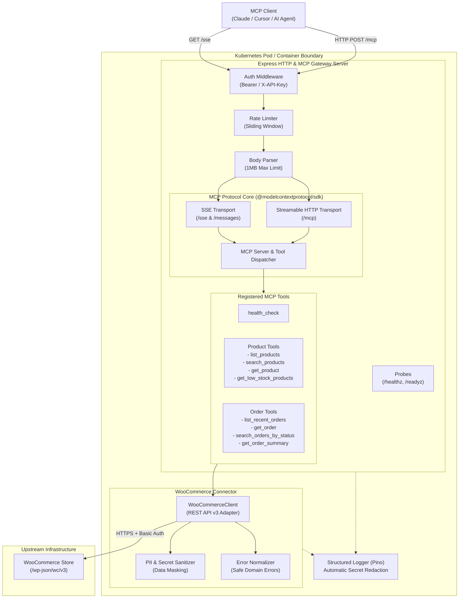
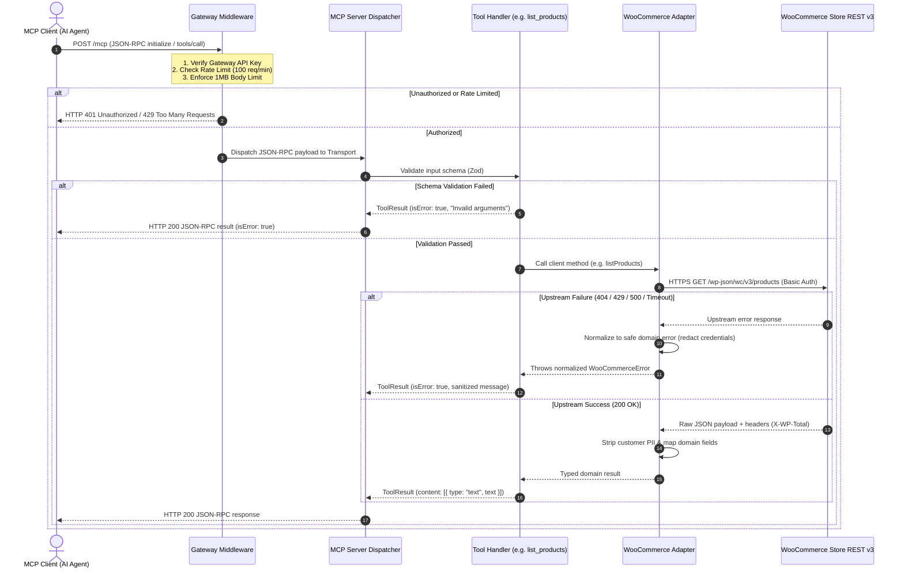

# Architecture & System Design

The **WooCommerce MCP Gateway** is a specialized, cloud-native microservice that bridges Model Context Protocol (MCP) clients (such as Claude Desktop, Cursor, and custom AI agents) with WooCommerce e-commerce platforms.

---

## 1. High-Level Architecture

The gateway is built on a layered, modular architecture that separates network protocol handling, authentication, MCP tool dispatching, and upstream REST API integration:



---

## 2. Request & Execution Flow



---

## 3. Core Architectural Components

### A. Modular Layering
- **[`src/config/`](file:///c:/Users/DELL/OneDrive/Desktop/woocommerce-mcp-gateway/src/config)**: Strict runtime validation using Zod. The gateway terminates immediately during boot (`exit(1)`) if required variables are missing or misconfigured.
- **[`src/gateway/`](file:///c:/Users/DELL/OneDrive/Desktop/woocommerce-mcp-gateway/src/gateway)**: Express 5 HTTP server hosting both the modern Streamable HTTP MCP transport (`POST /mcp`) and legacy Server-Sent Events (`GET /sse`, `POST /messages`), plus cluster health probes.
- **[`src/connectors/`](file:///c:/Users/DELL/OneDrive/Desktop/woocommerce-mcp-gateway/src/connectors)**: Resilient HTTP client targeting WooCommerce REST API v3 with configurable timeouts (`AbortController`), bounded response sizes, and exponential backoff retry.
- **[`src/tools/`](file:///c:/Users/DELL/OneDrive/Desktop/woocommerce-mcp-gateway/src/tools)**: Standardized MCP tools conforming to `@modelcontextprotocol/sdk` schemas and JSON-RPC 2.0 specifications.
- **[`src/middleware/`](file:///c:/Users/DELL/OneDrive/Desktop/woocommerce-mcp-gateway/src/middleware)**: Security middleware enforcing API token authentication, sliding-window rate limiting, payload bounding, CORS restrictions, and centralized error handling.
- **[`src/logging/`](file:///c:/Users/DELL/OneDrive/Desktop/woocommerce-mcp-gateway/src/logging)**: Structured JSON logger (`pino`) with deep key/value redaction for authentication tokens and credentials.

---

## 4. MCP Transport Strategy

| Transport Mode | Endpoint | Protocol Handling | Scaling Characteristics |
| :--- | :--- | :--- | :--- |
| **Streamable HTTP** *(Primary)* | `POST /mcp` | Stateless per request. Negotiates `protocolVersion: 2024-11-05` and streams SSE response chunks (`event: message\ndata: {...}`). | Scales effortlessly horizontally across multiple Kubernetes replicas with round-robin load balancing (`sessionAffinity: None`). |
| **Server-Sent Events** *(Legacy)* | `GET /sse`<br/>`POST /messages` | Stateful session maintained in memory. Clients hold an open SSE stream and send JSON-RPC commands via `POST /messages?sessionId=...`. | Single-replica only, or requires `sessionAffinity: ClientIP` when deployed with multiple replicas. |

---

## 5. Resilience & Error Handling Philosophy

1. **Fail-Safe Tool Invocation**: If an upstream WooCommerce API call fails (e.g., product not found, invalid store endpoint, or upstream 500 error), the gateway does **not** crash. It catches the error, redacts any embedded secrets, and returns an MCP-compliant result:
   ```json
   {
     "isError": true,
     "content": [
       {
         "type": "text",
         "text": "WooCommerce Product with ID '9999' was not found."
       }
     ]
   }
   ```
2. **Zero Internal Exposure**: Stack traces and raw internal error objects are logged internally at `error` level with secrets redacted, but are never exposed in external HTTP or JSON-RPC responses.
3. **Graceful Termination**: On receiving `SIGTERM` or `SIGINT`, the server stops accepting new connections, drains active in-flight requests within a 30-second window, and closes transports before exiting cleanly.
