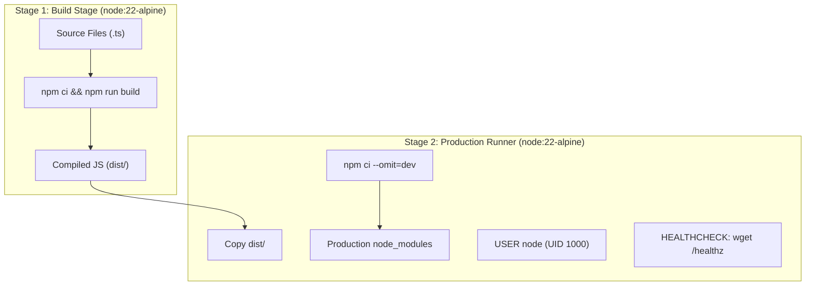
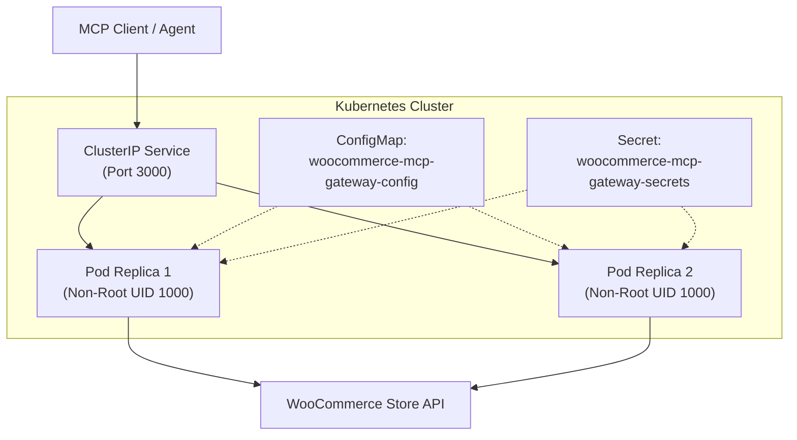

# Deployment & Operations Guide

This guide covers building, containerizing, deploying, and operating the **WooCommerce MCP Gateway** across local Docker environments and Kubernetes clusters.

---

## 1. Docker Containerization

The project uses a multi-stage Docker build (`Dockerfile`) pinned to `node:22.16.0-alpine3.21` for minimal image size and attack surface.



### Build the Image
```bash
docker build -t woocommerce-mcp-gateway:latest .
```

### Run Locally with Docker
```bash
docker run -d \
  --name woocommerce-mcp-gateway \
  -p 3000:3000 \
  -e NODE_ENV=production \
  -e PORT=3000 \
  -e WOOCOMMERCE_BASE_URL=https://your-store.example.com \
  -e WOOCOMMERCE_CONSUMER_KEY=ck_your_consumer_key \
  -e WOOCOMMERCE_CONSUMER_SECRET=cs_your_consumer_secret \
  -e GATEWAY_API_KEY=your_secure_client_api_key \
  woocommerce-mcp-gateway:latest
```

### Inspect Container
```bash
# Check running container status
docker ps -f name=woocommerce-mcp-gateway

# Stream container logs
docker logs -f woocommerce-mcp-gateway

# Verify health status
curl -i http://localhost:3000/healthz
```

---

## 2. Kubernetes Deployment Architecture

The [`k8s/`](file:///c:/Users/DELL/OneDrive/Desktop/woocommerce-mcp-gateway/k8s) directory provides production manifests designed for Minikube, Kind, or managed cloud clusters (Amazon EKS, Google GKE, Azure AKS):



### Manifests Inventory
- **[`k8s/namespace.yaml`](file:///c:/Users/DELL/OneDrive/Desktop/woocommerce-mcp-gateway/k8s/namespace.yaml)**: Dedicated `woocommerce-mcp` namespace.
- **[`k8s/deployment.yaml`](file:///c:/Users/DELL/OneDrive/Desktop/woocommerce-mcp-gateway/k8s/deployment.yaml)**: 2 replicas, `RollingUpdate` strategy, non-root security context (`USER node`, UID 1000), resource boundaries (100m–500m CPU, 128Mi–512Mi RAM), liveness/readiness probes, 30s graceful termination.
- **[`k8s/service.yaml`](file:///c:/Users/DELL/OneDrive/Desktop/woocommerce-mcp-gateway/k8s/service.yaml)**: Private `ClusterIP` exposing port 3000 internally.
- **[`k8s/configmap.yaml`](file:///c:/Users/DELL/OneDrive/Desktop/woocommerce-mcp-gateway/k8s/configmap.yaml)**: Non-sensitive runtime variables (`NODE_ENV`, `PORT`, `HOST`, `WOOCOMMERCE_BASE_URL`, `RATE_LIMIT_*`).
- **[`k8s/secret.example.yaml`](file:///c:/Users/DELL/OneDrive/Desktop/woocommerce-mcp-gateway/k8s/secret.example.yaml)**: Secret template for WooCommerce keys and Gateway API token.
- **[`k8s/kustomization.yaml`](file:///c:/Users/DELL/OneDrive/Desktop/woocommerce-mcp-gateway/k8s/kustomization.yaml)**: Declarative Kustomize resource manifest.

---

## 3. Step-by-Step Cluster Deployment

### Step 1: Prepare Secrets
Copy the template and populate real credentials:
```bash
cp k8s/secret.example.yaml k8s/secret.yaml
```
*Note: `k8s/secret.yaml` is excluded by `.gitignore` to prevent accidental Git commits.*

Alternatively, create the secret imperatively:
```bash
kubectl create secret generic woocommerce-mcp-gateway-secrets \
  --namespace=woocommerce-mcp \
  --from-literal=WOOCOMMERCE_CONSUMER_KEY="ck_your_key" \
  --from-literal=WOOCOMMERCE_CONSUMER_SECRET="cs_your_secret" \
  --from-literal=GATEWAY_API_KEY="your_api_key"
```

### Step 2: Apply Manifests
Deploy using `kubectl` or `kustomize`:
```bash
# Option A: Standard apply
kubectl apply -f k8s/namespace.yaml
kubectl apply -f k8s/configmap.yaml
kubectl apply -f k8s/secret.yaml
kubectl apply -f k8s/deployment.yaml
kubectl apply -f k8s/service.yaml

# Option B: Kustomize (recommended)
kubectl apply -k k8s/
```

### Step 3: Monitor Rollout
```bash
kubectl rollout status deployment/woocommerce-mcp-gateway -n woocommerce-mcp
```

---

## 4. Verification & Diagnostics

```bash
# 1. List pods and nodes
kubectl get pods -l app=woocommerce-mcp-gateway -o wide

# 2. View streaming logs across all replicas
kubectl logs -l app=woocommerce-mcp-gateway -f --tail=50

# 3. Inspect pod events and probe status
kubectl describe pods -l app=woocommerce-mcp-gateway

# 4. Port-forward internal ClusterIP service to local workstation
kubectl port-forward svc/woocommerce-mcp-gateway-service 3000:3000

# 5. Verify health probes over port-forward
curl -i http://localhost:3000/healthz
curl -i http://localhost:3000/readyz

# 6. Test MCP JSON-RPC protocol initialization
curl -i -X POST http://localhost:3000/mcp \
  -H "Content-Type: application/json" \
  -H "Accept: application/json, text/event-stream" \
  -H "Authorization: Bearer <YOUR_GATEWAY_API_KEY>" \
  -d '{
    "jsonrpc": "2.0",
    "id": 1,
    "method": "initialize",
    "params": {
      "protocolVersion": "2024-11-05",
      "capabilities": {},
      "clientInfo": { "name": "diagnostic-client", "version": "1.0.0" }
    }
  }'
```

---

## 5. Multi-Replica & Session Affinity Considerations

1. **Streamable HTTP Transport (`/mcp`)**: Stateless per request. Operates seamlessly under standard round-robin `ClusterIP` load balancing (`sessionAffinity: None`) with any replica count.
2. **Server-Sent Events (`/sse` + `/messages`)**: Stateful session holding. If clients connect via SSE across multiple replicas, configure `sessionAffinity: ClientIP` with a sticky timeout (e.g. `timeoutSeconds: 10800`).
3. **In-Memory Rate Limiting**: The built-in sliding window is memory-scoped to each individual pod instance. In high-scale deployments requiring global rate limit consistency across all pods, connect a Redis backend store.

---

## 6. Troubleshooting Guide

| Symptom | Probable Cause | Diagnostic Command | Resolution |
| :--- | :--- | :--- | :--- |
| `CrashLoopBackOff` | Missing required environment variables | `kubectl logs <pod-name>` | Verify `k8s/configmap.yaml` and `k8s/secret.yaml` have valid variables. |
| Pod unready (`0/1 Running`) | Upstream WooCommerce URL unreachable or unready | `kubectl describe pod <pod-name>` | Check `/readyz` probe response and verify network connectivity to `WOOCOMMERCE_BASE_URL`. |
| HTTP `401 Unauthorized` | Missing or mismatched `GATEWAY_API_KEY` | `kubectl logs <pod-name>` | Verify client passes matching `Authorization: Bearer <KEY>`. |
| HTTP `429 Too Many Requests` | Rate limit threshold exceeded | Check `RateLimit-*` headers | Increase `RATE_LIMIT_MAX_REQUESTS` in ConfigMap if necessary. |
| HTTP `413 Payload Too Large` | Request body exceeds 1MB | Inspect payload size | Reduce request size or increase `MAX_REQUEST_BODY_BYTES`. |

---

## 7. Cleanup

```bash
# Delete all deployed resources
kubectl delete -f k8s/
# Or via Kustomize:
kubectl delete -k k8s/
```
