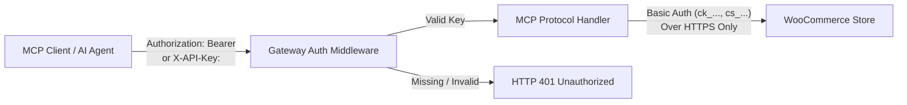
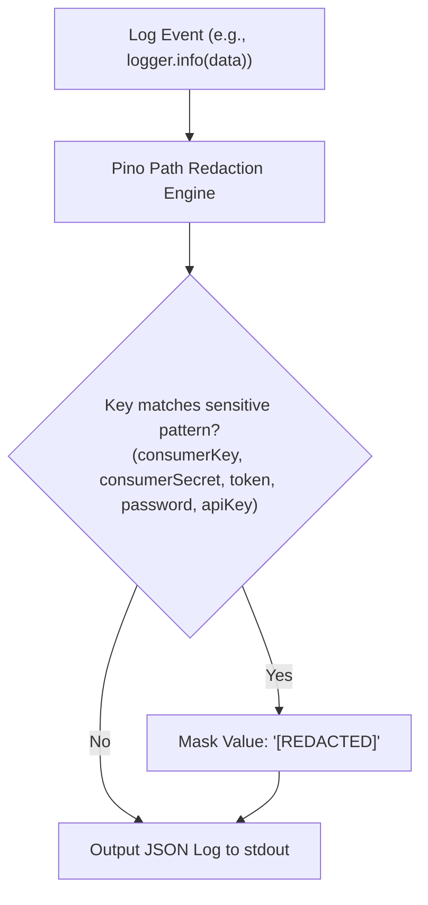

# Security Architecture & Controls

The **WooCommerce MCP Gateway** implements a defense-in-depth security model tailored for AI agent execution, microservice isolation, and enterprise data protection.

---

## 1. Authentication & Access Control



### Gateway Client Authentication
- Protected endpoints (`POST /mcp`, `GET /sse`, `POST /messages`) require authentication when `GATEWAY_API_KEY` is configured.
- Supported authentication headers:
  - `Authorization: Bearer <GATEWAY_API_KEY>`
  - `X-API-Key: <GATEWAY_API_KEY>`
- Health endpoints (`/healthz`, `/readyz`) and discovery metadata (`/`) remain publicly accessible within the cluster to allow Kubernetes probes without exposing tool execution.

### Upstream WooCommerce Credentials Isolation
- The gateway maintains complete separation between client gateway credentials and upstream WooCommerce API credentials.
- Upstream WooCommerce credentials (`WOOCOMMERCE_CONSUMER_KEY` and `WOOCOMMERCE_CONSUMER_SECRET`) are never exposed to clients, returned in tool content, or included in error payloads.
- Authentication to WooCommerce uses HTTP Basic Auth over TLS (`HTTPS`). Plaintext `HTTP` connections are rejected by default (permitted only when `NODE_ENV=development` or `NODE_ENV=test` on `localhost`).

---

## 2. Customer PII & Data Privacy

To comply with GDPR, CCPA, and enterprise privacy policies, the gateway strictly strips Personally Identifiable Information (PII) before returning order data to AI clients:

| Data Field | Upstream WooCommerce API | Gateway MCP Tool Result | Rationale |
| :--- | :--- | :--- | :--- |
| **Order ID & Number** | Included | Included | Required for order lookup and agent tracking |
| **Status & Currency** | Included | Included | Required for business workflows |
| **Financial Totals** | Included | Included | Required for accounting and verification |
| **Line Items & Quantities**| Included | Included | Required for inventory and fulfillment |
| **Billing/Shipping Email** | `customer@example.com` | **REMOVED** | Sensitive customer personal information |
| **Billing/Shipping Phone** | `+1-555-0199` | **REMOVED** | Sensitive customer personal information |
| **Street Address** | `123 Private St, Apt 4B` | **REMOVED** | Sensitive customer residential data |
| **Payment Credentials** | Token / CC details | **REMOVED** | PCI-DSS compliance |

---

## 3. Rate Limiting & DoS Prevention

- **Sliding-Window Rate Limiting**: Enforced via `src/middleware/rate-limit.middleware.ts`.
- **Default Limit**: 100 requests per minute per client IP (configurable via `RATE_LIMIT_WINDOW_MS` and `RATE_LIMIT_MAX_REQUESTS`).
- **Standard Headers**: Responses include RFC-compliant headers:
  - `RateLimit-Limit`: Maximum allowed requests within the window.
  - `RateLimit-Remaining`: Remaining request allowance.
  - `RateLimit-Reset`: Milliseconds remaining until quota resets.
- **Quota Exceeded**: Returns HTTP `429 Too Many Requests` with a `Retry-After` header.
- **Payload Size Limits**: Strict 1MB maximum payload enforcement (`MAX_REQUEST_BODY_BYTES: 1048576`). Payloads exceeding this limit receive HTTP `413 Payload Too Large`.

---

## 4. Structured Logging & Secret Redaction

The gateway uses `pino` for structured JSON logging with a dual-layer sanitization engine:



- **Redacted Keys**: `consumerSecret`, `consumer_secret`, `consumerKey`, `consumer_key`, `token`, `password`, `apiKey`, `GATEWAY_API_KEY`, `authorization`, `cookie`.
- **Error Object Sanitization**: When upstream HTTP errors are logged, HTTP headers containing Basic Auth strings are stripped before serialization.

---

## 5. Container & Kubernetes Pod Security

The container image and Kubernetes deployment manifests adhere to the **Kubernetes Restricted Pod Security Standard**:

- **Non-Root Execution**: Container runs strictly as unprivileged user `node` (`UID 1000`, `GID 1000`).
- **Read-Only Root Filesystem**: `readOnlyRootFilesystem: true` prevents malware persistence or runtime binary modification.
- **Temporary Storage**: An ephemeral `emptyDir` volume is mounted at `/tmp` for temporary Node.js operations.
- **Capability Dropping**: Container drops all Linux capabilities (`capabilities.drop: ["ALL"]`).
- **Privilege Escalation**: `allowPrivilegeEscalation: false` prevents setuid binaries from escalating privileges.
- **Seccomp Profile**: Configured with `seccompProfile: { type: "RuntimeDefault" }`.

---

## 6. Secret Management & Git Safety

1. **No Hardcoded Secrets**: Application code contains zero hardcoded API keys or store tokens.
2. **Ignored Manifests**: [`.gitignore`](file:///c:/Users/DELL/OneDrive/Desktop/woocommerce-mcp-gateway/.gitignore) contains explicit rules preventing secret leaks:
   ```gitignore
   .env
   .env.*
   k8s/secret.yaml
   k8s/*secret*.yaml
   !k8s/secret.example.yaml
   ```
3. **Safe Templates**: `k8s/secret.example.yaml` and `.env.example` provide documented templates containing only dummy placeholders.
