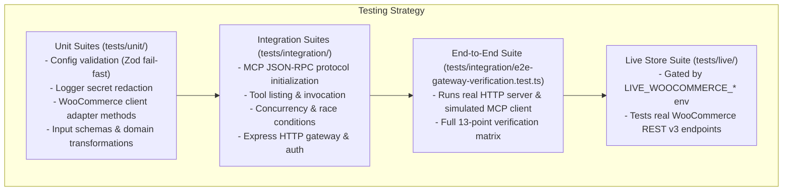

# Testing Strategy & Reliability

The **WooCommerce MCP Gateway** is thoroughly tested with an automated testing pyramid comprising unit tests, protocol integration tests, concurrency stress tests, and end-to-end verification.

---

## 1. Testing Pyramid & Structure



---

## 2. Test Suites Inventory

| Suite | File | Tests | Focus Area |
| :--- | :--- | :--- | :--- |
| **Config Unit** | [`tests/unit/config.test.ts`](file:///c:/Users/DELL/OneDrive/Desktop/woocommerce-mcp-gateway/tests/unit/config.test.ts) | 9 | Zod schema parsing, required field enforcement, URL validations, default fallbacks. |
| **Logger Unit** | [`tests/unit/logger.test.ts`](file:///c:/Users/DELL/OneDrive/Desktop/woocommerce-mcp-gateway/tests/unit/logger.test.ts) | 3 | Key redaction (`consumer_secret`, `consumer_key`, `token`, `password`, `apiKey`). |
| **WooCommerce Client** | [`tests/unit/woocommerce.client.test.ts`](file:///c:/Users/DELL/OneDrive/Desktop/woocommerce-mcp-gateway/tests/unit/woocommerce.client.test.ts) | 18 | REST API v3 queries, pagination headers (`X-WP-Total`), Basic Auth headers, 400/401/403/404/429/500 normalization, PII sanitization. |
| **Product Tools Unit** | [`tests/unit/products.tools.test.ts`](file:///c:/Users/DELL/OneDrive/Desktop/woocommerce-mcp-gateway/tests/unit/products.tools.test.ts) | 3 | `list_products`, `get_product`, `search_products`, `get_low_stock_products` inventory logic. |
| **Order Tools Unit** | [`tests/unit/orders.tools.test.ts`](file:///c:/Users/DELL/OneDrive/Desktop/woocommerce-mcp-gateway/tests/unit/orders.tools.test.ts) | 2 | `list_recent_orders`, `get_order`, `search_orders_by_status`, `get_order_summary`. |
| **Diagnostics Unit** | [`tests/unit/tools.test.ts`](file:///c:/Users/DELL/OneDrive/Desktop/woocommerce-mcp-gateway/tests/unit/tools.test.ts) | 2 | `health_check` registration and verbose payload formatting. |
| **MCP Protocol Integration** | [`tests/integration/mcp-protocol.test.ts`](file:///c:/Users/DELL/OneDrive/Desktop/woocommerce-mcp-gateway/tests/integration/mcp-protocol.test.ts) | 5 | In-memory transport client negotiation, capability exchange, tool listing, unknown tool errors. |
| **Product Tools Integration**| [`tests/integration/mcp-product-tools.test.ts`](file:///c:/Users/DELL/OneDrive/Desktop/woocommerce-mcp-gateway/tests/integration/mcp-product-tools.test.ts) | 7 | Real client tool invocation, stock filtering, price ranges, search matching. |
| **Order Tools Integration** | [`tests/integration/mcp-order-tools.test.ts`](file:///c:/Users/DELL/OneDrive/Desktop/woocommerce-mcp-gateway/tests/integration/mcp-order-tools.test.ts) | 5 | Order retrieval, financial calculations, strict customer PII stripping verification. |
| **Gateway HTTP Integration** | [`tests/integration/gateway-http.test.ts`](file:///c:/Users/DELL/OneDrive/Desktop/woocommerce-mcp-gateway/tests/integration/gateway-http.test.ts) | 9 | Express endpoints (`/healthz`, `/readyz`, `/`), Bearer/`X-API-Key` auth, 1MB body limit (`413`), rate limiting (`429`). |
| **Concurrency & Reliability** | [`tests/integration/concurrency-reliability.test.ts`](file:///c:/Users/DELL/OneDrive/Desktop/woocommerce-mcp-gateway/tests/integration/concurrency-reliability.test.ts) | 2 | 20x concurrent tool requests, graceful server shutdown during active in-flight calls. |
| **End-to-End Verification** | [`tests/integration/e2e-gateway-verification.test.ts`](file:///c:/Users/DELL/OneDrive/Desktop/woocommerce-mcp-gateway/tests/integration/e2e-gateway-verification.test.ts) | 13 | Complete 13-point verification covering network sockets, Streamable HTTP (`/mcp`), and mock WooCommerce server. |
| **Live Store (Optional)** | [`tests/live/woocommerce.live.test.ts`](file:///c:/Users/DELL/OneDrive/Desktop/woocommerce-mcp-gateway/tests/live/woocommerce.live.test.ts) | 2 | Live WooCommerce REST API v3 handshake (skipped by default unless configured). |

---

## 3. Running Automated Tests

```bash
# Run all unit and integration test suites
npm test

# Run unit tests only
npm run test:unit

# Run integration tests only
npm run test:integration

# Run standalone end-to-end verification script with colored matrix
npm run test:e2e

# Generate detailed V8 code coverage report
npm run test:coverage
```

---

## 4. Code Coverage Metrics

Automated test execution achieves **83.86% overall statement coverage** across the codebase:

```text
-------------------|---------|----------|---------|---------|-------------------
File               | % Stmts | % Branch | % Funcs | % Lines | Uncovered Line #s 
-------------------|---------|----------|---------|---------|-------------------
All files          |   83.86 |    61.74 |      86 |   83.86 |                   
 config            |   81.45 |    84.84 |      50 |   81.45 |                   
  env.ts           |   89.78 |     87.5 |     100 |   89.78 | 65-71,76-82       
 connectors        |   91.27 |    48.63 |   95.65 |   91.27 |                   
  ...rce.client.ts |   90.31 |    46.19 |     100 |   90.31 | ...54-455,458-459 
  ...rce.errors.ts |     100 |       90 |     100 |     100 | 15                
 logging           |      92 |       95 |     100 |      92 |                   
  logger.ts        |      92 |       95 |     100 |      92 | 97-104            
 middleware        |   77.43 |    76.66 |     100 |   77.43 |                   
  ...middleware.ts |   95.34 |       90 |     100 |   95.34 | 17-18             
  ...middleware.ts |     100 |      100 |     100 |     100 |                   
  ...middleware.ts |   88.88 |    84.61 |     100 |   88.88 | 25-30             
 tools             |   87.35 |       70 |     100 |   87.35 |                   
  health.tool.ts   |     100 |      100 |     100 |     100 |                   
  index.ts         |     100 |      100 |     100 |     100 |                   
  orders.tools.ts  |   85.08 |    68.75 |     100 |   85.08 | ...28-233,275-280 
  ...ucts.tools.ts |    85.5 |    63.15 |     100 |    85.5 | ...53-254,294-299 
-------------------|---------|----------|---------|---------|-------------------
```

---

## 5. Live Store Testing (Optional)

To validate the gateway against a real WooCommerce store:

1. Obtain a **Consumer Key** and **Consumer Secret** from your WooCommerce admin dashboard (`WooCommerce > Settings > Advanced > REST API`).
2. Set the environment variables:
   ```bash
   export LIVE_WOOCOMMERCE_BASE_URL="https://your-live-store.example.com"
   export LIVE_WOOCOMMERCE_CONSUMER_KEY="ck_live_consumer_key"
   export LIVE_WOOCOMMERCE_CONSUMER_SECRET="cs_live_consumer_secret"
   ```
3. Run the live suite:
   ```bash
   npm run test:live
   ```
   *(Note: Never run live integration tests against production stores during maintenance windows or peak sales periods).*
